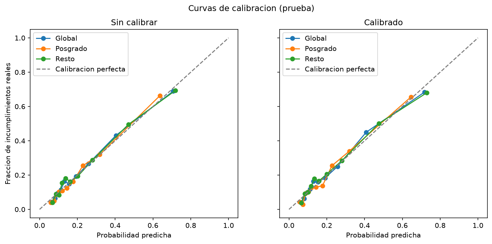
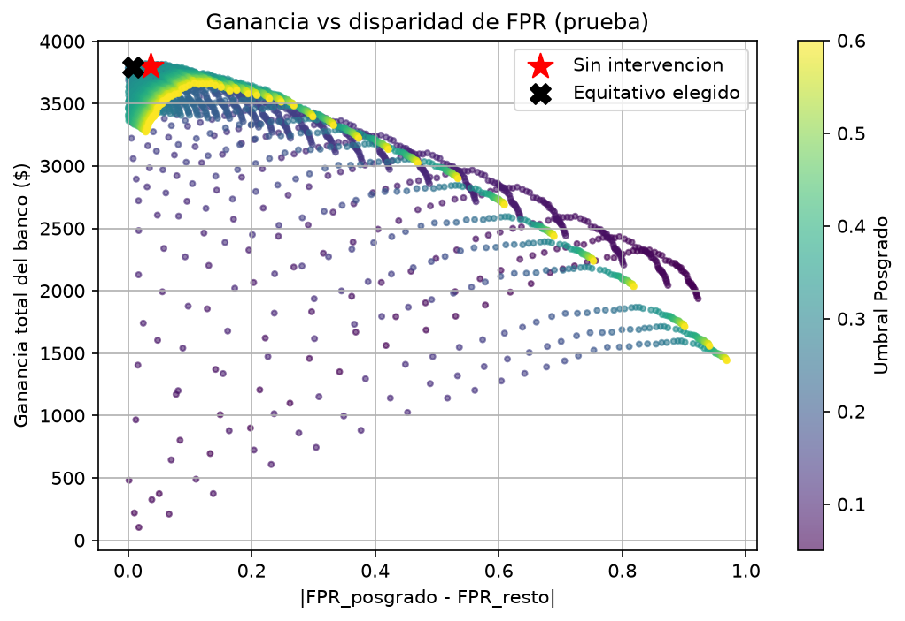

# Problema 1 — Equidad en un modelo de crédito (Default of Credit Card Clients)

## (a) Datos y modelo

- 30,000 clientes. 30 % para prueba (estratificado por la variable objetivo, con la semilla del curso).
- Se eliminó `ID` (no es una variable predictiva).
- Códigos no descritos: `EDUCATION` 0, 5 y 6 → 4 (otros); `MARRIAGE` 0 → 3 (otros). `PAY_x` con −2 y 0 se dejó como escala ordinal (sin atraso).
- **El atributo del grupo (`EDUCATION`) entra al modelo** en los incisos (a)-(d); en (e) se quita.
- Hiperparámetros elegidos con validación cruzada de 5 pliegues **solo en el entrenamiento** (logística: `C`, con escalado; boosting: árboles, tasa de aprendizaje y profundidad).

|  | Mejores hiperparámetros | AUC CV (entrenamiento) | AUC en prueba |
|---|---|---|---|
| Regresión logística | {'logisticregression__C': 1} | 0.7239 | 0.7174 |
| Gradient Boosting | {'learning_rate': 0.1, 'max_depth': 4, 'n_estimators': 50} | 0.7820 | 0.7774 |

El mejor modelo por AUC de validación cruzada es **Gradient Boosting**.

## (b) ¿Está calibrado?

**Sin calibrar** (prueba):

| grupo | n | score promedio | tasa real | brecha (score - real) | Brier |
|---|---|---|---|---|---|
| Global | 9,000 | 0.2206 | 0.2212 | -0.0006 | 0.1360 |
| Posgrado | 3,216 | 0.1954 | 0.1912 | 0.0041 | 0.1222 |
| Resto | 5,784 | 0.2346 | 0.2379 | -0.0033 | 0.1437 |

**Calibrado** (`CalibratedClassifierCV`, sigmoide, 5 pliegues dentro del entrenamiento):

| grupo | n | score promedio | tasa real | brecha (score - real) | Brier |
|---|---|---|---|---|---|
| Global | 9,000 | 0.2204 | 0.2212 | -0.0008 | 0.1359 |
| Posgrado | 3,216 | 0.1950 | 0.1912 | 0.0037 | 0.1217 |
| Resto | 5,784 | 0.2345 | 0.2379 | -0.0033 | 0.1437 |

El modelo sin calibrar ya estaba razonablemente calibrado en promedio (brechas menores a un punto porcentual). La brecha absoluta máxima entre puntaje promedio y tasa real pasó de **0.0041** a **0.0037** tras calibrar. El AUC en prueba pasó de 0.7774 a 0.7776: la calibración corrige la *escala* de las probabilidades, casi no cambia el *orden* de los clientes.

Calibrar de forma global no garantiza calibración por grupo: después de calibrar, la diferencia entre las brechas de Posgrado y Resto es **0.0071**. Un grupo con tasa real distinta puede quedar sobre o subestimado aunque el promedio global cuadre. Todo lo que sigue usa las probabilidades **calibradas**, porque solo así el umbral económico tiene sentido.

## Umbral del banco

Aprobar conviene si (1 − p)·G > p·L, es decir p < G/(G+L) = **0.2857**. El umbral óptimo empírico (búsqueda sobre predicciones fuera de muestra del entrenamiento, no sobre la prueba) es **t = 0.27**. Ese es el umbral que se usa en (c).

## (c) Tabla por grupo con el umbral del banco (t = 0.27)

|  | n | pg | rechazo | PPV | FPR | FNR |
|---|---|---|---|---|---|---|
| Posgrado (1) | 3,216 | 0.1912 | 0.1947 | 0.5064 | 0.1188 | 0.4846 |
| Resto (0) | 5,784 | 0.2379 | 0.2548 | 0.5353 | 0.1554 | 0.4266 |

**Verificación de la identidad** tasa de rechazo = pg·(1−FNR) + (1−pg)·FPR:

|  | tasa de rechazo | pg·(1−FNR) + (1−pg)·FPR | |diferencia| |
|---|---|---|---|
| Posgrado (1) | 0.194652 | 0.194652 | 0.000000 |
| Resto (0) | 0.254841 | 0.254841 | 0.000000 |

La identidad se cumple (diferencias del orden del error de máquina): es la ley de probabilidad total, así que si los grupos tienen distinta pg no se pueden igualar a la vez rechazo, FPR y FNR.

**Bootstrap** (1,000 remuestras de la prueba, semilla fija):

| diferencia | observada (Posgrado - Resto) | IC 95% inferior | IC 95% superior | ¿contiene 0? |
|---|---|---|---|---|
| FPR | -0.0366 | -0.0525 | -0.0200 | no |
| FNR | 0.0580 | 0.0076 | 0.1066 | no |

Conclusión: la de FPR **es real** (el intervalo no incluye 0); la de FNR **es real** (el intervalo no incluye 0).

## (d) Intervenir

**Definición elegida: igualdad de oportunidades medida con FPR.** Se busca que los buenos pagadores tengan la misma probabilidad de ser rechazados por error sin importar su escolaridad. Se usa un umbral por grupo, elegido en el entrenamiento (fuera de muestra) como el par de mayor ganancia con |dif. FPR| ≤ 0.01. Umbrales: **posgrado = 0.24, resto = 0.29**.

Tabla de nuevo (prueba) con los umbrales por grupo:

|  | n | pg | rechazo | PPV | FPR | FNR |
|---|---|---|---|---|---|---|
| Posgrado (1) | 3,216 | 0.1912 | 0.2285 | 0.4694 | 0.1499 | 0.4390 |
| Resto (0) | 5,784 | 0.2379 | 0.2405 | 0.5500 | 0.1420 | 0.4440 |

**Antes y después** (prueba; ganancia en unidades con G = 1):

| medida | Sin intervencion | Con intervencion |
|---|---|---|
| Ganancia total | 3,802.5 | 3,790.5 |
| Dif. absoluta de tasa de rechazo (paridad demografica) | 0.0602 | 0.0119 |
| Dif. absoluta de FPR | 0.0366 | 0.0079 |
| Dif. absoluta de FNR | 0.0580 | 0.0050 |
| Dif. absoluta de PPV (paridad predictiva) | 0.0289 | 0.0806 |

**Costo de ser justo:** 12.0 unidades (0.32 % de la ganancia sin intervención).

**¿Qué pasó con las otras definiciones?**

- Dif. absoluta de tasa de rechazo (paridad demografica): bajó de 0.0602 a 0.0119.
- Dif. absoluta de FPR: bajó de 0.0366 a 0.0079.
- Dif. absoluta de FNR: bajó de 0.0580 a 0.0050.
- Dif. absoluta de PPV (paridad predictiva): subió de 0.0289 a 0.0806.

Como las tasas reales de incumplimiento difieren entre grupos, igualar una métrica mueve las demás: no se pueden cumplir todas las definiciones a la vez salvo con un clasificador perfecto.

Bootstrap después de intervenir:

| diferencia | observada (Posgrado - Resto) | IC 95% inferior | IC 95% superior | ¿contiene 0? |
|---|---|---|---|---|
| FPR | 0.0079 | -0.0090 | 0.0248 | sí |
| FNR | -0.0050 | -0.0543 | 0.0420 | sí |

## (e) ¿Basta con no mirar?

Se reentrenó el mejor modelo (mismos hiperparámetros, mismo calibrador) **sin `EDUCATION`**. AUC en prueba: con el atributo **0.7776**, sin él **0.7778**.

Tabla sin el atributo (t = 0.27):

|  | n | pg | rechazo | PPV | FPR | FNR |
|---|---|---|---|---|---|---|
| Posgrado (1) | 3,216 | 0.1912 | 0.1903 | 0.5065 | 0.1161 | 0.4959 |
| Resto (0) | 5,784 | 0.2379 | 0.2538 | 0.5347 | 0.1549 | 0.4295 |

Diferencias Posgrado − Resto:

| medida | dif. con EDUCATION | dif. sin EDUCATION |
|---|---|---|
| rechazo | -0.0602 | -0.0635 |
| FPR | -0.0366 | -0.0388 |
| FNR | 0.0580 | 0.0664 |
| PPV | -0.0289 | -0.0282 |

Bootstrap sin el atributo:

| diferencia | observada (Posgrado - Resto) | IC 95% inferior | IC 95% superior | ¿contiene 0? |
|---|---|---|---|---|
| FPR | -0.0388 | -0.0546 | -0.0231 | no |
| FNR | 0.0664 | 0.0160 | 0.1141 | no |

**Variables relacionadas con el grupo** (correlación con `posgrado`, sin `EDUCATION`):

| variable | correlación con posgrado |
|---|---|
| LIMIT_BAL | 0.2588 |
| PAY_2 | -0.1692 |
| PAY_3 | -0.1602 |
| PAY_4 | -0.1524 |
| PAY_0 | -0.1427 |
| PAY_5 | -0.1387 |
| MARRIAGE | 0.1362 |
| PAY_6 | -0.1251 |
| AGE | -0.1004 |
| PAY_AMT3 | 0.0560 |

Predecir si un cliente es de posgrado con las demás variables da un AUC (CV) de **0.7385** (0.5 = sin información): los proxies son **fuertes**.

Perfil promedio por grupo (1 = posgrado):

| grupo | LIMIT_BAL | AGE | PAY_0 | BILL_AMT1 |
|---|---|---|---|---|
| 0 | 142693.26 | 36.17 | 0.10 | 52530.66 |
| 1 | 212956.07 | 34.23 | -0.23 | 48825.44 |

**Conclusión:** las diferencias **no desaparecen** al quitar el atributo. Las demás variables reconstruyen bien la escolaridad (proxies fuertes), así que el modelo puede "mirar" el grupo aunque no se lo demos. Además, si las tasas reales de incumplimiento (pg) difieren entre grupos, un modelo que acierte puede rechazar a los grupos de forma distinta aun sin ver el atributo. No mirar no es sinónimo de ser equitativo.

## (f) Memorándum al consejo (borrador, ≤ 1 página)

> **Para:** Consejo del banco. **De:** equipo de análisis. **Asunto:** ¿Tratamos igual a clientes con y sin posgrado?
>
> **Qué encontramos.** Analizamos 30,000 clientes de un banco de Taiwán (2005) con un modelo que decide a quién aprobar una tarjeta; los resultados vienen de 9,000 clientes que el modelo no había visto. Con un solo criterio para todos, se rechaza al 19.5 % de quienes tienen posgrado y al 25.5 % del resto. De cada 100 personas que sí habrían pagado, se rechaza por error a 11.9 con posgrado y a 15.5 del resto; de cada 100 que no habrían pagado, se aprueba por error a 48.5 y a 42.7, respectivamente. La diferencia entre grupos al rechazar por error a buenos pagadores es estadísticamente real, no casualidad. Quitar la escolaridad del modelo no basta: las diferencias se mantienen, en parte porque otras variables (la más ligada es LIMIT_BAL) están relacionadas con ella.
>
> **Qué recomendamos.** Recomendamos que un cliente que sí iba a pagar tenga la misma probabilidad de ser aprobado, sea o no de posgrado. Se logra con un criterio de corte distinto por grupo. Con el ajuste, los buenos pagadores rechazados por error son 15.0 y 14.2 de cada 100 (posgrado y resto). Es la que evita que un cliente cumplido sea rechazado por pertenecer a un grupo. No es posible igualar todas las medidas de justicia a la vez, porque los grupos no tienen la misma tasa real de incumplimiento; por eso hay que elegir una.
>
> **Cuánto cuesta.** La ganancia del banco baja 12 unidades de 3,802 (0.3 %). Sugerimos revisar estas diferencias por grupo cada trimestre.

